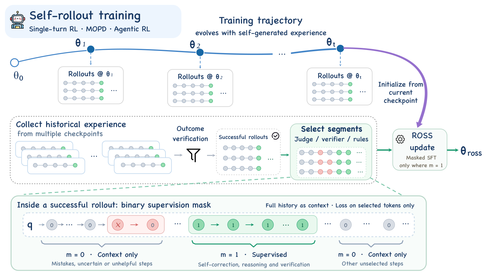

<div align="center">

# ROSS
### Relearning from Self-Generated Rollouts through Selective Supervision

**Reuse historical rollouts. Keep the full context. Learn from selected tokens.**

[Why ROSS?](#why-ross) · [Method](#method) · [Main Results](#main-results) · [Quick start](#quick-start) · [Training](#training) · [Data](#data) · [Repository](#repository) · [Hugging Face](https://huggingface.co/papers/2609.35954) · [arXiv](https://arxiv.org/abs/2609.35954)

</div>

ROSS reuses historical self-generated rollouts through selective supervision, preserving the full trajectory as context while learning from selected model-generated tokens.

This repository includes the single-turn and agentic annotation pipelines, reviewer prompts, a Slime-based training framework, reference RL/MOPD/ROSS launch scripts, and Math, CodeIO, and instruction-following training splits.

## Why ROSS?

Reinforcement learning (RL) and on-policy distillation discover useful behaviors throughout training, but the final policy may not reproduce them reliably. Even successful rollouts can contain mistakes and unnecessary detours, making full-trajectory imitation suboptimal. ROSS adds an **offline masked supervised fine-tuning (SFT) stage after RL, multi-teacher on-policy distillation (MOPD), or agentic RL**. It reuses the final checkpoint and saved rollouts to consolidate useful behaviors without collecting additional policy rollouts or interacting with the environment.

## Method

<p align="center">
  
</p>

1. **Collect and verify.** Pool saved rollouts from earlier checkpoints of the same training run and retain verifier-positive trajectories.
2. **Review and select.** An LLM reviewer identifies useful supervision targets; independent auditing and boundary checks reject unreliable annotations. Math and CodeIO use positive-span selection; agentic tasks localize defects in assistant turns. Verifier-positive instruction-following responses retain full-response supervision.
3. **Relearn with masked SFT.** Initialize from the final upstream checkpoint and apply loss only to selected model-generated tokens. The complete original history, including unselected text and tool observations, remains available as context.

The reviewer selects supervision targets from the saved rollout; it does not rewrite responses or generate replacement answers. **Masking removes tokens from the loss, not from the input sequence.**

## Main Results

Results with **Qwen3.6-35B-A3B** from Tables 1 and 2 of the [paper](https://arxiv.org/abs/2609.35954). ROSS relearns from saved rollouts, starting from the corresponding **Upstream** checkpoint (the final RL or MOPD model). Scores are percentages; higher is better. Gains are percentage-point improvements over Upstream.

| Training setting | Evaluation metric | Base | Upstream | ROSS | Gain |
|---|---|---:|---:|---:|---:|
| Math RL | Math average | 72.81 | 75.19 | **76.98** | **+1.79** |
| Code RL | Code average | 39.72 | 42.09 | **44.21** | **+2.12** |
| MOPD | Six-benchmark average | 55.33 | 58.40 | **62.20** | **+3.80** |
| Agentic RL | SWE-bench Verified | 60.80 | 64.20 | **68.40** | **+4.20** |

Math averages AIME 2025, AIME 2026, and HMMT-November 2025; Code averages LCB Gen and OJBench. MOPD averages these five benchmarks plus IFBench. Math RL and Code RL are separate training runs. Single-turn experiments use no-thinking mode; agentic experiments use thinking mode.

## Repository

| Path | Contents |
|---|---|
| [`single_turn/`](single_turn/README.md) | Math, CodeIO, and instruction-following annotation and reviewer prompts |
| [`agentic/`](agentic/README.md) | Coding-agent trajectory review, defect localization, and mask export |
| [`training/`](training/README.md) | Training setup and RL/MOPD/ROSS launchers |
| [`training/reference/`](training/reference/README.md) | Concrete experiment presets and their required inputs |
| [`training/framework/`](training/framework/) | Bundled Slime-based framework and ROSS training adapters |
| [`data/rl_mopd/`](data/rl_mopd/README.md) | Upstream training data, schemas, and provenance notes |
| [`data/prepare_single_turn_sft.py`](data/prepare_single_turn_sft.py) | Join annotations with original rollouts to build masked-SFT records |

## Quick start

Run the commands below from the repository root. Annotation uses an OpenAI-compatible chat-completions endpoint; configure your reviewer model and endpoint. The paper uses **GLM-5.2 in high-thinking mode** for rollout review and mask annotation.

```bash
python -m venv .venv
source .venv/bin/activate
pip install -r requirements.txt

export ROSS_ENDPOINT=http://localhost:8000/v1/chat/completions
export ROSS_MODEL=your-judge-model
```

For an authenticated endpoint, supply `ROSS_API_KEY` through your environment. See the pipeline documentation for authentication-header options.

### Single-turn annotation

Place your verifier-positive rollout records in `data/verifier_positive.jsonl` using the [input schema](single_turn/README.md#input), then annotate and export:

```bash
python single_turn/run.py \
  --input data/verifier_positive.jsonl \
  --output outputs/single_turn_annotations.jsonl \
  --workers 8

python data/prepare_single_turn_sft.py \
  --source data/verifier_positive.jsonl \
  --annotations outputs/single_turn_annotations.jsonl \
  --output outputs/ross_sft.jsonl
```

Inputs contain the prompt, response, verifier reward, and task metadata. The converter keeps the complete response and attaches `sft_char_spans` to partially supervised assistant messages. Rejected or unresolved annotations are withheld. The training adapter projects these character spans onto the original tokenization; [`token_alignment.py`](token_alignment.py) documents the general alignment contract. See the [single-turn guide](single_turn/README.md) for the schema.

### Agentic annotation

Prepare verified step exports and the corresponding original message records, then run:

```bash
python agentic/prepare.py --input data/step_exports --output artifacts/prepared
python agentic/run.py --prepared artifacts/prepared --root artifacts/annotations --workers 16
python agentic/export_masks.py \
  --input data/messages.jsonl \
  --prepared artifacts/prepared \
  --annotations artifacts/annotations \
  --output outputs/agentic_masked.jsonl
```

The exporter withholds incomplete or unresolved annotations. See the [agentic guide](agentic/README.md) for step serialization, tool-call alignment, and mask semantics.

## Training

Use a Linux CUDA environment with compatible PyTorch, SGLang, Megatron-LM, and model checkpoints. Install the bundled framework in that environment:

```bash
pip install -e training/framework
```

The launchers submit to an **existing Ray cluster**. Set absolute paths shared by every node and adjust GPU counts and parallelism for your hardware. The reference defaults target multi-GPU training. Checkpoints, frozen teachers, and annotated historical SFT sets must be supplied separately.

### Upstream RL and MOPD

Start with the [RL/MOPD guide](training/RL_MOPD.md) for cluster setup, checkpoint conversion, model configuration, and teacher routing. Concrete presets include:

| Stage | Reference script |
|---|---|
| Three-domain 35B MOPD | [`mopd_35b_three_domain.sh`](training/reference/mopd_35b_three_domain.sh) |
| 4B Math RL | [`rl_4b_math.sh`](training/reference/rl_4b_math.sh) |
| 35B ROSS, initialized from MOPD | [`ross_35b_mopd199_first200.sh`](training/reference/ross_35b_mopd199_first200.sh) |
| 35B ROSS, Base initialization comparison | [`ross_35b_base_first200.sh`](training/reference/ross_35b_base_first200.sh) |

The optional `TG_OPD_MODE` switch is retained: ordinary RL defaults to `off`, and MOPD defaults to `selected_opd`. Online and offline TGOPD modes are documented in the [training guide](training/RL_MOPD.md).

### ROSS masked SFT

For example, after preparing compatible single-turn SFT records and checkpoints:

```bash
export HF_CHECKPOINT=/path/to/compatible_hf_model_and_tokenizer
export MOPD_REF_LOAD=/path/to/mopd_iter199_distributed
export MEGATRON_DIR=/path/to/Megatron-LM
export PROMPT_DATA="$PWD/outputs/ross_sft.jsonl"
export OUTPUT_DIR=/path/to/ross_sft_output

DRY_RUN=1 bash training/reference/ross_35b_mopd199_first200.sh
# After checking paths, model configuration, and Ray resources:
# bash training/reference/ross_35b_mopd199_first200.sh
```

The concrete ROSS presets enable the bundled **single-turn** span-mask adapter. Model/tokenizer compatibility and input files are checked even in dry-run mode. Filter oversized records with the matching tokenizer and adjust the historical save interval if your usable dataset size changes; see the [preset guide](training/reference/README.md).

Agentic exports use `sft_region_exclude` and require the separate [trainer integration contract](training/README.md#loss-mask-contract). The bundled historical single-turn adapter does not support this field. [`training/run_masked_sft.sh`](training/run_masked_sft.sh) is a generic template for trainers with the mask hook integrated.

## Data

| Domain | Records | File |
|---|---:|---|
| Math | 3,000 | [`math/train.jsonl`](data/rl_mopd/math/train.jsonl) |
| CodeIO | 11,980 | [`codeio/train.jsonl`](data/rl_mopd/codeio/train.jsonl) |
| Instruction following | 10,000 | [`if/train.jsonl`](data/rl_mopd/if/train.jsonl) |
| **Total** | **24,980** | |

These are **upstream RL/MOPD task inputs and verifier specifications**. ROSS SFT additionally needs saved model rollouts and accepted supervision annotations; the three splits are not pre-annotated ROSS SFT data.

```bash
python data/prepare_rl_mopd.py --output artifacts/rl_mopd/train.jsonl
```

The mixture builder concatenates the three domains and shuffles with seed 42. See the [data guide](data/rl_mopd/README.md) for schema and provenance details.

## Acknowledgments

The bundled training framework builds on Slime and its dependencies.

## License

ROSS-owned code is released under the [Apache License 2.0](LICENSE). Third-party code and datasets retain their respective terms; see [third-party notices](THIRD_PARTY_NOTICES.md).

## Citation

If you find this work useful for your research, please consider citing our paper:

```bibtex
@article{zhang2026ross,
  title={ROSS: Relearning from Self-Generated Rollouts through Selective Supervision},
  author={Zhang, Zhiwei and Deng, Huayu and Zhao, Fei and Fu, Jiayan and Liang, Bin and Wong, Kam-Fai and Chuan, Mu},
  journal={arXiv preprint arXiv:2609.35954},
  year={2026}
}
```
